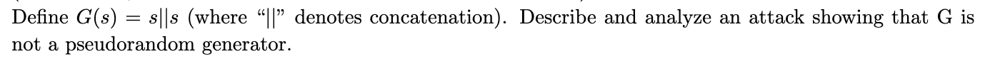

In my [previous post](), I gave you some intuition for pseudorandom generators (PRGs) and pseudorandom functions (PRFs), but it was pretty handwavy. Now let's make it a little more precise.

<!-- Just yesterday, in my tutorial session, I was discussing solutions to the most recent homework on proving and disproving that a certain given geneator algorithm is a pseudorandom function. Looking at the blank faces, I was thinking what a terrible teacher I am, with all this notation on my slide, of course students are going to stare at me like I'm crazy. I'm pretty sure I too would have thought what an ugly subject, let's find something else, if I didn't know any better. -->

You're given a generator algorithm. Is it a pseudorandom generator? Do you know when to say no? The next series of posts will be:

- Part 2: You're given a generator algorithm. Is it a pseudorandom generator? Do you know when to say yes?
- Part 3: You're given a keyed function. Is it a pseudorandom function? Do you know when to say no?
- Part 4: You're given a keyed function. Is it a pseudorandom function? Do you know when to say yes?

For this blog post, we're going to solve the following question from Katz and Lindell's "Introduction to Modern Cryptography":

You're probably wondering what even is this, and that's okay. We'll start from the very basics.

What is a pseudorandom generator? Let's call it $$G$$. Pseudorandom generator $$G$$ generates a sequence of bits that "look" random i.e. are pseudorandom.

How does $$G$$ output a pseudorandom string? Of course, not out of thin air. $$G$$ is an algorithm, that takes as input a short random string called the seed $$s$$ and produces a pseudorandom string $$G(s)$$ that is strictly longer than this seed $$s$$ because otherwise what's the point? $$G$$ is essentially generating a huge random string from a tiny random string. Let's formalize this notion.

**Expansion property**: Suppose $$s$$ is any $$n$$-bit string. For any $$n$$, $$G(s)$$ is a string of length $$\ell(n)$$ such that $$\ell(n) > n$$ (the Expansion property).

What does pseudorandom mean? $$G(s)$$ is indistinguishable from a random string of the same length. In other words, there is no distinguisher that can distinguish between $$G(s)$$ and a random string. The distinguisher here is an efficient algorithm (if thought of as a person, remember the person's reasoning to distinguish can also be captured in an algorithm). Let's formalize this notion.

**Pseudorandomness property**: For any efficient distinguishing algorithm $$D$$, there is a negligible function $$\mathsf{negl}$$ such that

$$
\left| \Pr[D(G(s)) = 1] - \Pr[D(r) = 1] \right| \le \mathsf{negl}(n).
$$

Ewww, let's break that down. Suppose the distinguisher is given some string $$y$$. The probability of guessing this string to be a PRG output i.e. $$G(s)$$ when $$y$$ is actually $$G(s)$$ should be almost equal to the probability of guessing this string to be a PRG output when the string $$y$$ is actually a random string $$r$$. Which makes sense intuitively right? Suppose you're given adulterated milk vs real milk. If you really can't tell the difference, you're going to guess "real milk!" just as often irrespective of whether you're given adulterated milk or real milk.

 The first term $$\Pr[D(G(s)) = 1]$$ is the probability of guessing $$y$$ to be $$G(s)$$ correctly. The second term $$\Pr[D(r) = 1]$$ is the probability of guessing $$y$$ to be $$G(s)$$ wrongly, when $$y$$ is actually $$r$$. Instead of saying almost equal informally, we say their difference is negligible. Whatever be the value of $$n$$, the difference should be negligible, so we define negligible as a function of $$n$$ called $$\mathsf{negl}(n)$$.

Pop quiz time:

1. Let $$G(x) = x$$ for $$x \in \{0, 1\}^n$$. Is $$G$$ a PRG? (Hint: Does it satisfy the expansion property?)

**Answer.** Not a PRG, because expansion property fails.

{: start="2"}
2. Let $$G(s) = s+1$$ for $$s \in \{0, 1\}^n$$. Is $$G$$ a PRG? (Hint: Does it satisfy the expansion property?)

**Answer.** Not a PRG, because expansion property fails in general (it may succeed if $$s$$ is all 1s but the seed $$s$$ should be allowed to be **any** random $$n$$-bit string.)

{: start="3"}
3. Let $$G(s) = s \vert\vert s$$ for $$s \in \{0, 1\}^n$$ where $$\vert\vert$$ denotes concatenation. Is $$G$$ a PRG? (Hint: Does it satisfy the pseudorandomness property?)

**Answer.** Okay clearly, $$G(s)$$ here is strictly longer than $$s$$. So expansion property is satisfied. What does it mean to satisfy the pseudorandomness property?

Suppose the distinguisher is given some string $$y$$, which could belong to only two worlds:

- **World 0**: $$y$$ is a uniformly random string.
- **World 1**: $$y$$ is a PRG output i.e. $$y = G(s)$$ for some random $$n$$-bit seed $$s$$.

Can the distinguisher tell? Don't you think $$s \vert\vert s$$ seems unlikely to be a random string? Why? You see some pattern in $$s \vert\vert s$$? And in your head, you're like "a random string can't have patterns!". Your intuition is right. Let's formalize that.

Imagine yourself to be the distinguisher. The pattern you notice is that the first half of $$y$$ is equal to the second half of $$y$$. So this is what you do.

**Distinguishing algorithm**: If first half of $$y$$ = second half of $$y$$, output World 1 (PRG output), else output World 0 (uniformly random string).

By the definition of pseudorandomness, the (probability of guessing World 1 correctly) - (probability of wrongly guessing World 1) is negligible.

What's the probability of guessing World 1 correctly? In other words, given that $$y$$ is from World 1, what's the probability that the distinguisher will guess World 1? The distinguisher will ALWAYS guess World 1! So the probability is 1 here i.e. $$\Pr[D(G(s)) = 1] = 1$$.

So now by the definition of pseudorandomness, 1 - (probability of wrongly guessing World 1) is negligible.

What's the probability of wrongly guessing World 1? In other words, given that $$y$$ is from World 0, what's the probability that the distinguisher will guess World 1? Notice that if $$y$$ were a random string, it seems highly unlikely for the left half of $$y$$ to be equal to the right half of $$y$$. It seems highly unlikely for the distinguisher to wrongly guess World 1. The only time the distinguisher WILL guess wrongly, is when the left half of a random string is actually equal to the right half. What's the probability of that? For every choice of left half (there are $$2^n$$ possible bit strings left half can take, therefore $$2^n$$ choices), we're asking, what is the probability that the right half is equal to this choice? The answer is $$1/2^n$$.

The distinguisher will wrongly guess World 1 with a probability of $$1/2^n$$ i.e. $$\Pr[D(r) = 1] = 1/2^n$$.

$$\left\lvert \Pr[D(G(s)) = 1] - \Pr[D(r) = 1] \right\rvert = 1 - 1/2^n$$ which is definitely not negligible.

Pseudorandomness property is not satisfied. So $$G(s) = s \vert\vert s$$ is not a PRG.

Phew! We've decoded some complicated notation today. I took some really simple examples, but with the harder examples, the only complexity is typically computing the probabilities correctly, and maybe formalizing your "pattern" into an actual distinguishing algorithm.

So if you're given a generator algorithm and asked whether it is a pseudorandom generator. Do you know when to say no?
