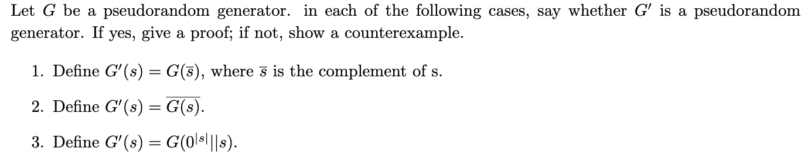

You're given a generator algorithm. Is it a pseudorandom generator? Do you know when to say yes?

For this blog post, we're going to solve the first two of the following questions from Katz and Lindell's "Introduction to Modern Cryptography":

This post is more involved than the previous post ["Part 1: You're given a generator algorithm. Is it a pseudorandom generator? Do you know when to say no?"]() but worry not, I do intend to leave you with enough intuition so that you're looking forward to understand more complex topics.

Let's start with the first question.

1. Given that $$G$$ is a PRG, is $$G'(s) = G(\bar{s})$$ a PRG?

Note that $$G: \{0, 1\}^n \rightarrow \{0, 1\}^{2n}$$ and $$G': \{0, 1\}^n \rightarrow \{0, 1\}^{2n}$$.

Let's recall the properties that $$G'$$ would need to have to earn the title of PRG.

**Expansion property**: $$G'(s)$$ should be strictly longer than $$s$$ (in terms of no. of bits).

We know that $$G$$ is a PRG. This means that $$G(\bar{s})$$ is strictly longer than $$\bar{s}$$. Since $$s$$ and $$\bar{s}$$ are of the same length, then in turn this implies that $$G(\bar{s})$$ is strictly longer than $$s$$. Since output length of $$G'(s)$$ is equal to output length of $$G(\bar{s})$$, $$G'(s)$$ is strictly longer than $$s$$. Expansion property satisfied. Yay.

Next, **Pseudorandomness property**: $$G'(s)$$ should be distinguishable from a random string of same length with negligible probability.

Now, we know that $$G$$ is a PRG. This means that $$G(s)$$ is indistinguishable from a random string of same length when $$s$$ is a **uniformly random** $$n$$-bit string. If $$s$$ is uniformly random, then so is $$\bar{s}$$. So $$G(\bar{s})$$ is also indistinguishable from a random string of same length.

Pseudorandomness property satisfied. Yay. $$G'$$ is a PRG.

Next question: proving the pseudorandomness property is not going to be as simple.

{: start="2"}
2. Given that $$G$$ is a PRG, is $$G'(s) = \overline{G(s)}$$ a PRG?

Let's check the **Expansion property**.

We know that $$G$$ is a PRG. This means that $$G(s)$$ is strictly longer than $$s$$. $$\overline{G(s)}$$ is the same length as $$G(s)$$ and is therefore also strictly longer than $$s$$. This implies $$G'(s)$$ is strictly longer than $$s$$. Expansion property satisfied. Yay.

Let's check the **Pseudorandomness property**. We need this to be satisfied. For every distinguisher $$D'$$,

$$
\left| \Pr[D'(G'(s)) = 1] - \Pr[D'(r) = 1] \right| \le \mathsf{negl}(n).
$$

And we are going to prove this holds via contradiction.

Suppose $$G'$$ is not pseudorandom. That means there exists a distinguisher $$D'$$ that can distinguish between $$G'(s)$$ and a random string with non-negligible probability which means

$$
\left| \Pr[D'(G'(s)) = 1] - \Pr[D'(r) = 1] \right| > \mathsf{negl}(n).
$$

Remember $$G$$ is pseudorandom. Suppose a different distinguisher $$D$$, which tries to distinguish between whether a string $$y$$ is an output of $$G(s)$$ or a random string, works as follows:

{: type="a"}
1. Send $$\overline{y}$$ to $$D'$$.
2. Output the guess of $$D'$$.

$$\Pr[D(G(s)) = 1] = \Pr[D'(G'(s)) = 1]$$. But why? If $$y$$ was indeed the output of $$G(s)$$, then not($$y$$) which is $$\overline{y}$$ received by $$D'$$ is indeed $$\overline{G(s)} = G'(s)$$. So if $$D'$$ guessed $$G'$$ correctly, then surely $$D$$ guessed $$G$$ correctly.

$$\Pr[D(r) = 1] = \Pr[D'(r) = 1]$$. But why? If $$y$$ was a random string $$r$$, then $$\overline{y}$$ received by $$D'$$ is $$\overline{r}$$, which is also a uniformly random string. If $$D'$$ guessed $$G'$$ wrongly for string $$\overline{y}$$, then $$D$$ basically just used $$D'$$, $$D$$ must have guessed $$G$$ wrongly for string $$y$$.

So if

$$
\left| \Pr[D'(G'(s)) = 1] - \Pr[D'(r) = 1] \right| > \mathsf{negl}(n).
$$

Then

$$
\left| \Pr[D(G(s)) = 1] - \Pr[D(r) = 1] \right| > \mathsf{negl}(n).
$$

And this is a contradiction to the pseudorandomness property of $$G$$. Therefore $$G'$$ must be pseudorandom.

And that's it for now. What you learned today is known very fancily as the "reduction argument". Until next time then!