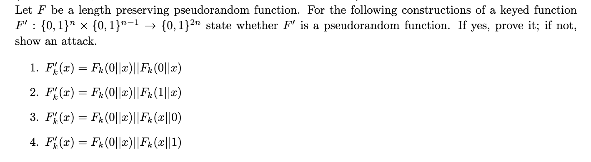

You're given a keyed function. Is it a pseudorandom function? Do you know when to say no?

In [Part 1](), we were asking the same question about generators. Now we're asking it about functions. We're going to solve exercises 1, 3, and 4 of the following question from Katz and Lindell's "Introduction to Modern Cryptography":

Before we dive in, let's talk about what makes a PRF different from a PRG.

**What's a pseudorandom function?**

A PRG takes a short random seed $$s$$ and produces a pseudorandom string $$G(s)$$ that is longer. A PRF is different. It's a keyed function $$F_k: \{0,1\}^n \rightarrow \{0,1\}^n$$ that takes a key $$k$$ and an input $$x$$, and produces an output that "looks like" the output of a truly random function on input $$x$$.

What is a truly random function? A truly random function $$f: \{0,1\}^n \rightarrow \{0,1\}^n$$ is one where for every possible input, the output is an independently chosen uniformly random $$n$$-bit string. Think of it as a random lookup table. This table is huge ($$2^n$$ entries corresponding to all possible $$n$$-bit string inputs), so we can't actually store it. But a PRF $$F_k$$ simulates such a table using just an $$n$$-bit key $$k$$.

So now that we understand what a truly random function is, how do we formalize this notion of "looks like" the output of a truly random function?

What we want to say is that $$F_k$$ is indistinguishable from $$f$$, where $$f$$ is a truly random function on the same domain and codomain (both $$n$$-bit strings here), even when the distinguisher gets to see outputs on many inputs of its choice. The distinguisher here is an efficient algorithm (if thought of as a person, remember the person's reasoning to distinguish can also be captured in an algorithm). Let's formalize this notion.

Unlike in PRGs, the PRF-distinguisher is a little more powerful. In case of PRGs, the distinguisher was just given a random-looking string and asked to guess whether it was a random string or a PRG output. In case of PRFs, the distinguisher gets to make queries: they pick any inputs $$x_1, x_2, \dots, x_q$$ they want (polynomially many, since the distinguisher is efficient) and get the outputs. They then have to decide whether these were outputs of $$F_k$$ (for some fixed but unknown key $$k$$) or the outputs of a truly random function $$f$$.

**Pseudorandomness property for PRFs**: For any efficient distinguisher $$D$$,

$$
\left| \Pr[D^{F_k(\cdot)}(1^n) = 1] - \Pr[D^{f(\cdot)}(1^n) = 1] \right| \le \mathsf{negl}(n).
$$

Let's break that down. Suppose the distinguisher is given the outputs of several queries, let's call them $$y_1, y_2, \dots, y_q$$. The probability of guessing these came from $$F_k$$ should be almost the same whether $$y_1, \dots, y_q$$ actually came from $$F_k$$ or from a truly random function $$f$$. Just like in PRGs, the distinguisher's mission is to tell $$F_k(x_1), \dots, F_k(x_q)$$ apart from $$f(x_1), \dots, f(x_q)$$, and the pseudorandomness property says they can't.

The first term $$\Pr[D^{F_k(\cdot)}(1^n) = 1]$$ is the probability of guessing $$y_1, y_2, \dots, y_q$$ to be outputs of $$F_k$$ correctly. The second term $$\Pr[D^{f(\cdot)}(1^n) = 1]$$ is the probability of guessing $$y_1, y_2, \dots, y_q$$ to be the outputs of $$F_k$$ wrongly, when these are actually outputs of truly random function $$f$$.

And instead of saying "almost equal" informally, we say their difference is negligible — a function of $$n$$ we write as $$\mathsf{negl}(n)$$.

Pop quiz time. For all our exercises, $$F$$ is a **length-preserving** PRF. So $$F: \{0,1\}^n \times \{0,1\}^n \rightarrow \{0,1\}^n$$. And $$F'$$ is a new keyed function $$F': \{0,1\}^n \times \{0,1\}^{n-1} \rightarrow \{0,1\}^{2n}$$.

---

**Exercise 1**: $$F'_k(x) = F_k(0 \| x) \| F_k(0 \| x)$$. Here, $$F_k$$ is given to be a PRF. Is $$F'_k$$ a PRF?

For $$F'_k$$ to be a PRF, $$F'_k(x)$$ should be indistinguishable from $$f(x)$$ where $$f$$ is a truly random function. $$f(x)$$ is a uniformly random $$2n$$-bit string. But $$F'_k(x)$$ seems to have a pattern. The left half of the output is equal to the right half! Surely this can't be the output of a truly random function!

Sound familiar? This is the PRF version of $$G(s) = s\|s$$ from [Part 1](). The same idea works here.

Suppose the distinguisher queries its oracle on any input $$x$$ and receives output $$y$$. There are two worlds:

- **World 0 (random function)**: $$y$$ is a uniformly random $$2n$$-bit string.
- **World 1 (PRF)**: $$y = F_k(0\|x) \| F_k(0\|x)$$.

**Distinguishing algorithm**: if the first half of $$y$$ equals the second half, output World 1; otherwise output World 0.

What's the probability of guessing World 1 correctly? In World 1, the two halves are always equal by construction, so the distinguisher always outputs World 1: $$\Pr[D = 1] = 1$$.

What's the probability of wrongly guessing World 1? In World 0, the two $$n$$-bit halves are independently random, so they match with probability $$2^{-n}$$: $$\Pr[D = 1] = 2^{-n}$$.

$$\left| \Pr[D^{F'_k(\cdot)} = 1] - \Pr[D^{f(\cdot)} = 1] \right| = 1 - 2^{-n}.$$

This is not negligible. $$F'$$ is **not a PRF**.

---

**Exercise 3**: $$F'_k(x) = F_k(0 \| x) \| F_k(x \| 0)$$

Found any pattern in $$F'_k$$ yet? The left half = right half trick won't work anymore, the two halves now use different inputs: $$0\|x$$ (prepend a 0) and $$x\|0$$ (append a 0). Both are $$n$$-bit strings. Really no pattern? Remember the PRF-distinguisher is more powerful than the PRG-distinguisher. The pattern might not exist in general, but it might exist for *some* x. Let's check: is there any $$x$$ where $$0\|x = x\|0$$?

$$0\|x = 0, x_1, x_2, \ldots, x_{n-1}$$

$$x\|0 = x_1, x_2, \ldots, x_{n-1}, 0$$

For these to be equal: $$0 = x_1$$, $$x_1 = x_2$$, $$\ldots$$, $$x_{n-2} = x_{n-1}$$, $$x_{n-1} = 0$$. This forces $$x_1 = x_2 = \cdots = x_{n-1} = 0$$. So there is exactly one such input: $$x = 0^{n-1}$$ (the all-zeros string).

For this special input: $$F'_k(0^{n-1}) = F_k(0^n) \| F_k(0^n)$$. Left half = right half!

Suppose the distinguisher queries its oracle on $$x = 0^{n-1}$$ and receives output $$y$$. There are two worlds:

- **World 0 (random function)**: $$y$$ is a uniformly random $$2n$$-bit string.
- **World 1 (PRF)**: $$y = F_k(0^n) \| F_k(0^n)$$.

**Distinguishing algorithm**: if the first half of $$y$$ equals the second half, output World 1; otherwise output World 0.

What's the probability of guessing World 1 correctly? In World 1, the two halves are always equal at $$x = 0^{n-1}$$, so the distinguisher always outputs World 1: $$\Pr[D = 1] = 1$$.

What's the probability of wrongly guessing World 1? In World 0, the two halves are independently random, so they match with probability $$2^{-n}$$: $$\Pr[D = 1] = 2^{-n}$$.

$$\left| \Pr[D^{F'_k(\cdot)} = 1] - \Pr[D^{f(\cdot)} = 1] \right| = 1 - 2^{-n}.$$

Not negligible. $$F'$$ is **not a PRF**.

---

**Exercise 4**: $$F'_k(x) = F_k(0 \| x) \| F_k(x \| 1)$$

The pattern of left half = right half may not exist in general, but we ask again, does it exist for *some* x? Can $$0\|x = x\|1$$ for some $$x$$?

$$0\|x = 0, x_1, \ldots, x_{n-1}$$

$$x\|1 = x_1, x_2, \ldots, x_{n-1}, 1$$

For equality: $$0 = x_1$$, $$x_1 = x_2$$, $$\ldots$$, $$x_{n-2} = x_{n-1}$$, $$x_{n-1} = 1$$. The first condition gives $$x_1 = 0$$, but then $$x_{n-1} = x_{n-2} = \cdots = x_1 = 0$$, contradicting $$x_{n-1} = 1$$. No single input creates equal halves.

So the left half = right half trick won't work with a single query. But what if we use **two queries**?

Can the **first half** of one query equal the **second half** of a different query? That is, can $$0\|x = x'\|1$$ for two different inputs $$x$$ and $$x'$$? Yes! Take:

- $$x = 0^{n-2}\|1$$
- $$x' = 0^{n-1}$$

Now you see how **first half** of $$F'_k(x)$$ always equals the **second half** of $$F'_k(x')$$?

Suppose the distinguisher queries both $$x = 0^{n-2}1$$ and $$x' = 0^{n-1}$$, receiving outputs $$y$$ and $$y'$$. There are two worlds:

- **World 0 (random function)**: $$y$$ and $$y'$$ are independent uniformly random $$2n$$-bit strings.
- **World 1 (PRF)**: $$y = F_k(0^{n-1}1) \| F_k(0^{n-2}11)$$ and $$y' = F_k(0^n) \| F_k(0^{n-1}1)$$.

**Distinguishing algorithm**: if the first half of $$y$$ equals the second half of $$y'$$, output World 1; otherwise output World 0.

What's the probability of guessing World 1 correctly? In World 1, both values are $$F_k(0^{n-1}1)$$, so they're always equal: $$\Pr[D = 1] = 1$$.

What's the probability of wrongly guessing World 1? In World 0, the two values are independently random $$n$$-bit strings, so they match with probability $$2^{-n}$$: $$\Pr[D = 1] = 2^{-n}$$.

$$\left| \Pr[D^{F'_k(\cdot)} = 1] - \Pr[D^{f(\cdot)} = 1] \right| = 1 - 2^{-n}.$$

Not negligible. $$F'$$ is **not a PRF**.

---

And that's it for now. In PRGs, you were given a generator algorithm, where the pattern was right there. In PRFs, the pattern exists for a particular input, and may not be so explicit in general. The objective of the distinguisher is the same though: to formalize this pattern in order to say "no".

So if you're given a keyed function and asked whether it is a pseudorandom function. Do you know when to say no?

In Part 4, we'll ask the harder question: when do you say yes?